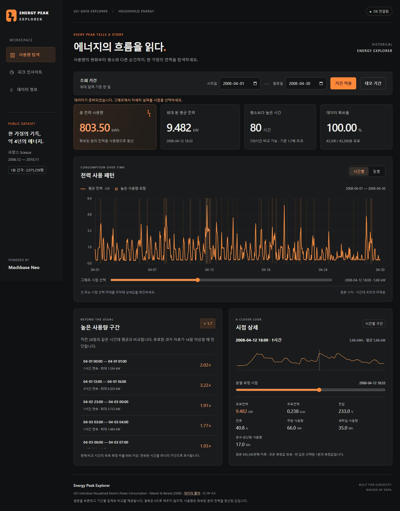

# Energy Peak Explorer

공개된 가정용 전력 자료를 Machbase DBMS에 저장하고 브라우저에서 사용량과 피크를 탐색하는 작은 데모 앱입니다. **AGENTS.md와 대화로 요구사항을 정리하고, 개발 계획을 검토한 뒤 앱을 만드는 예제**로 사용할 수 있습니다.

**이 저장소에는 DB와 입력된 데이터가 포함되어 있지 않습니다.** 완성된 앱을 실행하려면 각자의 PC에서 원본을 내려받고, 자신의 Machbase DB에 데이터를 입력해야 합니다. 아래 절차는 **DB에 이 앱의 자료가 아직 없는 첫 실행**을 기준으로 합니다.



## 사용 방법 선택

| 하고 싶은 일 | 준비할 것 | 안내 |
| --- | --- | --- |
| Codex와 대화하면서 직접 개발해 보기 | 새 작업 폴더의 `AGENTS.md`와 `data/household_power_consumption.txt`, Codex와 실행 중인 Neo | [AGENTS.md와 데이터로 직접 개발하기](docs/BUILD_WITH_CODEX.md) |
| 완성된 앱을 다운로드하여 실행하기 | 저장소 전체 소스, Neo, Python 3.11 이상, PowerShell 7 | 아래 ‘완성된 앱 실행하기’ 순서. Codex는 필요하지 않습니다. |

직접 개발하는 경우에는 완성 앱의 테이블과 데이터를 먼저 만들 필요가 없습니다. 준비한 지침·원본과 원하는 기능을 설명하고, 계획을 검토한 다음 개발을 요청합니다.

## 주요 기능

- 날짜를 선택하면 총 사용량(kWh), 최대 분 평균 전력(kW)과 발생 시각, 그래프가 함께 갱신됩니다.
- 한 번에 최대 달력 기준 한 달을 조회하며, 초과하면 시작일을 유지하고 종료일을 자동 조정합니다.
- 시간별·일별 그래프와 선택 구간의 분별 측정값 7개를 확인할 수 있습니다.
- 시간 평균 전력이 직전 28일 같은 시간대 평균의 **1.7배를 초과**한 구간을 표시합니다.
- 결측은 0으로 채우지 않으며 데이터 확보율과 판단 보류 상태를 구분합니다.

## 구성과 검증 환경

```text
브라우저 → JSH HTTP 서버(127.0.0.1:5680)
              → 내장 machcli → Machbase Native DB(127.0.0.1:5656)

UCI 원본 → JSH 스트리밍 파싱·append → 앱 전용 TAG 테이블
```

서버와 적재 프로그램은 Machbase Neo **JSH**에서 실행합니다. Node.js나 npm 패키지는 필요하지 않습니다. 정적 화면은 HTML/CSS/JavaScript와 SVG로 구성했습니다.

확인한 환경은 **Windows 10 AMD64 / PowerShell 7 / Neo 8.7.3 / DBMS 8.7.3 Standard**입니다. 다른 OS와 버전은 검증하지 않았습니다. Python 3.11 이상은 데이터 다운로드·원본 검산과 API 테스트에 사용합니다.

Neo HTTP API `5654`, DB Native 연결 `5656`, 이 앱 HTTP `5680`은 서로 다른 포트입니다. 앱은 서버 측 계정 설정으로 Native DB에 연결하고 브라우저에 DB 비밀번호를 전달하지 않습니다.

## 완성된 앱 실행하기

**처음 한 번:** 소스 준비 → Neo 실행 → DB 설정 → 데이터 다운로드 → 원본 확인 → DB 입력·검증 → 앱 실행 → 브라우저 접속.

**두 번째부터:** Neo 실행 확인 → 앱 실행 → 브라우저 접속. 같은 PC·프로젝트·DB를 계속 사용하면 매번 데이터를 다시 넣지 않습니다.

### 1. 소스와 실행 환경 준비

GitHub의 **Code → Download ZIP**으로 저장소 전체를 받아 압축을 풉니다. `README.md`, `run.ps1`, `server/`, `scripts/`가 함께 있는 폴더가 **프로젝트 폴더**입니다. 개별 파일만 받으면 완성 앱을 실행할 수 없습니다.

Git을 사용하는 경우에는 다음 명령으로 받을 수도 있습니다.

```powershell
git clone https://github.com/machbase/neo-demo-energy-peak.git
Set-Location neo-demo-energy-peak
```

필요한 실행 환경은 Neo, Python 3.11 이상, PowerShell 7입니다. Python은 데이터 준비·검산에 쓰며 앱 서버는 JSH로 실행합니다. [Machbase Neo 설치](https://docs.machbase.com/neo/) 후 Neo를 먼저 실행합니다. 이미 실행 중이면 다시 실행하거나 기존 설정을 바꾸지 않습니다.

Windows 런처를 쓰는 경우 설치 폴더의 `neow.exe`를 열고 **machbase-neo serve** 버튼으로 시작할 수 있습니다. [공식 Windows 시작 안내](https://docs.machbase.com/neo/getting-started/start-stop/#windows)를 참고합니다.

Neo를 명령으로 처음 실행하는 경우, **별도 PowerShell 창**에서 설치 폴더로 이동해 다음을 실행할 수 있습니다. 이 창은 켜 둡니다. Neo 런처나 기존 서비스로 실행 중이라면 이 단계는 건너뜁니다.

```powershell
Set-Location '<NEO_DIR>'
.\machbase-neo.exe serve
```

이 명령은 공식 시작 방식이며 설치된 실행 파일의 도움말에서 확인했습니다. 이번 문서 정리에서는 기존 Neo를 중지하거나 새 DB 서버를 추가로 실행하지 않았습니다.

다른 **앱 작업용 PowerShell 7 창**을 열고 다음을 실행합니다. 이후 2~7단계의 명령은 이 창에서 순서대로 실행합니다. `<PROJECT_DIR>`은 압축을 푼 프로젝트 폴더, `<NEO_DIR>`은 자신의 Neo 설치 폴더로 바꿉니다.

```powershell
Set-Location '<PROJECT_DIR>'
$NeoExe = Join-Path '<NEO_DIR>' 'machbase-neo.exe'
& $NeoExe version
python --version
```

Neo 버전과 Python 3.11 이상의 버전이 출력되어야 합니다. 이 앱의 실제 검증 환경은 Neo 8.7.3 / DBMS 8.7.3 Standard입니다.

### 2. 서버 측 DB 설정

프로젝트 폴더에서 자신의 비공개 설정을 만듭니다. 예제만 제공되며 실제 계정 설정은 공유하지 않습니다. 기존 설정이 있으면 덮어쓰지 않습니다.

```powershell
if (-not (Test-Path config/local.json)) {
    Copy-Item config/example.json config/local.json
}
```

메모장 등으로 `config/local.json`을 열고 다음 예시의 `<DB_PASSWORD>`를 자신의 DB 비밀번호로 바꾼 뒤 저장합니다. `user`는 해당 DB에서 앱 전용 테이블을 생성하고 입력·조회할 수 있는 계정이어야 합니다.

```json
{
  "host": "127.0.0.1",
  "port": 5656,
  "user": "sys",
  "password": "<DB_PASSWORD>",
  "address": "127.0.0.1:5680"
}
```

`host`·`port`는 DB Native 연결 주소입니다. `address`는 브라우저가 접속할 앱 주소입니다. 자신의 Native 포트가 다르면 `port`를 수정합니다. 기본 앱 포트 `5680`이 다른 프로그램에서 쓰이고 있으면 `address`를 `127.0.0.1:5681`처럼 바꾸고, 뒤의 접속·상태 확인 주소도 같은 포트로 바꿉니다.

`config/local.json`과 `runtime/`은 `.gitignore`에서 제외합니다. 실제 비밀번호를 예제 설정이나 README에 넣지 마세요. 실제 설정은 이 저장소에 포함되어 있지 않습니다.

### 3. 원본 데이터 다운로드

앱 작업용 PowerShell에서 프로젝트 폴더에 있는 상태로 실행합니다.

```powershell
python scripts/download_data.py
```

정상 완료 시 다음 파일이 생기고 `DOWNLOADED and VERIFIED`가 출력됩니다.

```text
data/household_power_consumption.txt
```

원본은 약 133MB이므로 저장소에 포함하지 않았습니다. 공식 UCI ZIP과 추출한 텍스트의 SHA-256을 검증하며 기존 정상 원본이 있으면 `VERIFIED existing source`를 출력하고 다운로드를 건너뜁니다. 다른 내용의 파일이 같은 이름으로 있으면 덮어쓰지 않고 중단합니다.

직접 [UCI 데이터셋](https://archive.ics.uci.edu/dataset/235/individual+household+electric+power+consumption)에서 받은 원본을 위 위치에 두어도 됩니다. 자세한 출처와 해시는 [data/README.md](data/README.md)에 있습니다. **이 단계는 파일을 준비할 뿐 DB에는 아직 입력하지 않습니다.**

### 4. 원본 확인 보고서 생성

```powershell
python scripts/profile.py
```

전체 파일의 행 수·결측·월별 합계 등을 계산해 `reports/source-profile.json`을 만듭니다. 2,075,259행과 원본 SHA-256이 출력되어야 합니다. 완료까지 시간이 걸릴 수 있습니다. **이 단계도 DB 입력 전 준비 작업입니다.**

### 5. 자신의 DB에 전체 데이터 입력

Neo가 실행 중이고 2단계 설정을 저장했는지 확인한 뒤 실행합니다. SQL을 직접 입력하거나 테이블을 미리 만들 필요는 없습니다.

```powershell
.\scripts\load.ps1 -NeoExe $NeoExe
```

이 프로그램은 다음 작업을 수행합니다.

1. 원본 파일의 해시를 확인합니다.
2. 자신의 Neo DB에 앱 전용 TAG 테이블 `EPX_HOUSEHOLD_MINUTE_V1`을 새로 만듭니다.
3. 전체 2,075,259행을 JSH append로 입력합니다. 결측 행도 상태를 보존합니다.
4. 전송 결과와 실제 조회 건수를 비교합니다.
5. 성공 시 **자신의 프로젝트 폴더**에 `runtime/import.json` 완료 기록을 만듭니다.

진행 중 `SENT 100000` 같은 출력이 나오며, 처음 정상 입력한 경우 마지막에 다음 결과가 나와야 합니다.

```text
APPEND_CLOSE [2075259,0]
VERIFIED 2075259 rows
```

다음으로 저장된 값과 원본 집계를 대조합니다.

```powershell
& $NeoExe jsh -v "/energy=$PWD" /energy/scripts/verify.js
```

정상 결과:

```text
PASS 2075259 rows, 48 months, 13 samples; all 7 missing counts match
```

파일과 프로그램의 역할은 다음과 같습니다.

| 프로그램 | 역할 |
| --- | --- |
| `scripts/download_data.py` | UCI 원본 다운로드·해시 확인 |
| `scripts/profile.py` | 원본의 건수·집계 기준값 생성 |
| `scripts/load.ps1` | DB 입력을 시작하는 Windows 명령 |
| `scripts/import.js` | 위 명령이 실행하는 실제 JSH 테이블 생성·전체 append 프로그램 |
| `scripts/verify.js` | 자신의 DB 조회 결과를 원본 기준값과 대조 |

약 207만 행을 스트리밍으로 읽어 10,000행마다 flush합니다. 조회 반영이 늦으면 최대 60초 동안 조회만 재시도합니다. 조회 건수가 부족하다는 이유로 데이터를 자동 재입력하지 않습니다.

같은 프로젝트·같은 DB에서 입력을 다시 실행하면 `EXISTING_IMPORT: verify only, no append`를 출력하고 조회 검증만 수행합니다. 부분 입력·출처를 알 수 없는 기존 테이블·해시 불일치는 자동으로 덮어쓰거나 삭제하지 않습니다. 실패한 경우 아래 오류 안내를 확인합니다. `runtime/import.json`은 중복 방지를 위해 보존하며, 다른 사람이나 다른 DB의 완료 기록을 복사해서 사용하지 않습니다.

### 6. 앱 실행

```powershell
.\run.ps1 -NeoExe $NeoExe
```

정상 실행 시 `Energy Peak Explorer http://127.0.0.1:5680`이 출력되고 계속 실행 상태로 남습니다. 이 창을 켜 둡니다. 첫 실행에서는 `config/local.json`과 성공한 DB 입력 기록이 모두 있어야 합니다.

### 7. 브라우저 접속과 화면 확인

같은 PC의 웹브라우저에서 **[http://127.0.0.1:5680/](http://127.0.0.1:5680/)** 를 엽니다. Neo의 `5654` 화면이 아닌, 이 앱의 `5680` 주소입니다. 설정에서 앱 포트를 바꿨다면 바뀐 주소를 사용합니다.

원본을 정상 입력한 경우 첫 화면은 **2008-04-01~2008-04-30**입니다. 표시값을 확인하는 기준은 사용량 **803.50 kWh**, 최대 분 평균 전력 **9.482 kW**, 발생 시각 **2008-04-12 18:33:00**, 확보율 **100%**입니다. 이는 공개 원본의 검산 기준이며 DB를 함께 배포했다는 뜻이 아닙니다.

별도의 PowerShell 창에서 다음 요청으로 상태를 확인할 수도 있습니다.

```powershell
Invoke-RestMethod 'http://127.0.0.1:5680/api/health'
```

정상이면 `status: ok`, `rows: 2075259`를 반환합니다. 날짜를 변경하면 자동 조회하며 `데모 기간`으로 초기 날짜로 돌아갑니다. 그래프 클릭 또는 시점 막대의 방향키로 구간을 고르고, 상세 패널의 분별 막대로 개별 관측값을 확인할 수 있습니다.

### 8. 앱 종료와 다음 실행

가장 간단한 종료 방법은 **앱을 실행한 PowerShell 창에서 Ctrl+C**를 누르는 것입니다. 브라우저 탭만 닫으면 서버는 계속 실행됩니다.

다른 PowerShell 창에서 종료하려면 프로젝트 폴더로 이동하고 실행 파일 변수를 다시 지정합니다. 변수는 창 사이에 자동으로 공유되지 않습니다.

```powershell
Set-Location '<PROJECT_DIR>'
$NeoExe = Join-Path '<NEO_DIR>' 'machbase-neo.exe'
.\stop.ps1 -NeoExe $NeoExe
```

정상 결과는 `Energy Peak Explorer 앱만 중지했습니다. 원본과 DB, 기존 Neo는 보존됩니다.`입니다. 앱 응답의 PID·실행 파일·시작 시각을 확인한 뒤 해당 앱 프로세스만 중지합니다. 앱이 이미 종료됐거나 상태를 확인할 수 없으면 임의의 프로세스를 중지하지 않고 오류로 알립니다.

앱을 종료해도 원본·DB 데이터·설정·적재 기록은 남고 Neo도 계속 실행됩니다. 다음 사용 시에는 Neo가 실행 중인지 확인하고, 프로젝트 폴더에서 `$NeoExe`를 다시 지정한 뒤 `run.ps1`만 실행하면 됩니다. 데이터 준비·입력은 매번 반복할 필요가 없습니다.

`config/local.json`을 바꾸면 앱을 종료하고 다시 실행해야 적용됩니다. 기존 Neo 재시작은 필요하지 않습니다.

## 계산 기준

| 항목 | 규칙 |
| --- | --- |
| 총 사용량 | 유효한 분 평균 전력의 합을 60으로 나눈 kWh. 결측을 추정하거나 전체 기간으로 외삽하지 않습니다. |
| 최대 전력 | 순간 최대값이 아닌 분 평균 전력의 최대값. 동률이면 최초 시각을 대표로 표시합니다. |
| 높은 사용량 | 직전 28일 같은 시간대 평균의 1.7배 초과. 현재·과거 시간별 유효 비율 90% 이상이고 과거 유효 일수가 14일 이상일 때 판단합니다. 일별 화면에서도 탐지는 시간 기준입니다. |
| 한 달 | 시작일 포함·달력상 1개월 뒤 제외. 월말은 다음 달 마지막 유효 날짜로 보정합니다. 예: 2008-01-31 시작이면 상한은 2008-02-29 00:00, 화면 종료일은 2008-02-28입니다. |
| 시각 | 시간대 오프셋 없는 원본 날짜시각을 그대로 표시합니다. 저장·비교용 UTC 좌표를 사용하지만 실제 UTC 관측이라고 주장하지 않고 한국 시간·서머타임으로 임의 변환하지 않습니다. |

`EPX_HOUSEHOLD_MINUTE_V1` TAG에 전체 행을 저장합니다. 수정하지 않는 숫자 시계열이므로 TAG를 선택했습니다. 필수 SUMMARIZED 컬럼은 NULL을 허용하지 않아 원본 행 번호 `SOURCE_ROW`를 사용하고, 전력 등 측정값 7개는 nullable DOUBLE로 보존합니다. `QUALITY`의 7비트는 각 측정값의 결측 여부입니다.

## 추가 검증과 개발 당시 기록

앱 실행 중 프로젝트 폴더에서 다음 명령을 실행합니다.

```powershell
& $NeoExe jsh -v "/energy=$PWD" /energy/tests/model.js
python tests/api.py
```

개발 환경에서 JSH 계산 검사 13개와 HTTP 검사 38개를 통과했습니다. DB는 전체 건수, 48개 월 구간의 합계·최대값·시각·동률, 13개 상세 샘플과 7개 컬럼의 결측 건수를 독립 원본 계산과 대조했습니다. 데모 720시간의 높은 사용량 판정도 원본에서 따로 계산한 결과와 일치했습니다.

검증 기록은 `reports/`에 참고용으로 포함했습니다. **이전 개발 환경의 결과이며, 새 사용자의 DB 입력 완료 기록이 아닙니다.** 자신의 입력·검증을 실행하면 보고서가 자신의 결과로 갱신됩니다. 개발 문서에서 ‘입력 완료’라고 적힌 부분도 과거 개발 확인을 뜻합니다.

합계 비교 허용 오차는 `max(1e-7, |기대 합계| × 1e-10)`이며 화면에서만 반올림합니다. 브라우저에서 기간 조정·다른 달·키보드 선택·390px/1440px 배치를 확인했습니다. 이번 문서 개정에서는 기존 DB를 지우거나 빈 DB에 전체 재적재하지 않았습니다. Neo 장애·PC 재부팅·외부 공개·서비스 자동 실행은 시험하지 않았습니다.

## 오류 해결

| 상황 | 확인 방법 |
| --- | --- |
| 앱 연결 실패 | 실행 출력과 `5680` 포트를 확인합니다. 앱을 중복 실행하지 않습니다. |
| DB 연결 실패 | Neo 실행 여부, Native `5656`, 비공개 계정 설정을 확인합니다. 인증을 끄지 않습니다. |
| 해시 불일치 | 원본과 다운로드 기록을 확인합니다. 다른 파일로 덮어쓰지 않습니다. |
| `Private DB configuration required` | `config/local.json`을 만들고 `<DB_PASSWORD>`를 자신의 값으로 바꿨는지 확인합니다. |
| `runtime/import.json` 없음·`Verified import required` | DB 입력 전 앱을 시작한 경우입니다. 3~5단계를 마친 뒤 실행합니다. |
| 부분 적재·알 수 없는 테이블 | `runtime/import.json`과 DB 건수를 조사합니다. 자동 삭제·재입력하지 않습니다. |
| `pending_visibility` | 완료 전송 기록이 있으면 적재 명령 재실행으로 조회 검증만 수행합니다. |
| `import.lock` 존재 | 다른 적재나 강제 종료 여부를 먼저 조사합니다. 무조건 lock을 지우고 재입력하지 않습니다. |

## 공유하는 파일과 각자 만드는 자료

| 구분 | 내용 |
| --- | --- |
| 저장소에 제공 | 앱 소스, AGENTS.md, 예제 설정, 데이터 다운로드·입력·검증 프로그램, 설명서, 참고 검증 기록 |
| 각자 준비 | Neo 실행 환경, 다운로드한 원본 텍스트, 자신의 DB 계정 설정 |
| 실행하며 각자 생성 | 자신의 DB 테이블·입력 데이터, `runtime/import.json`, `runtime/server.json`, 로그 |
| 저장소에서 제외 | DB 파일, 실제 비밀번호가 있는 `config/local.json`, `runtime/`, 약 133MB 원본 텍스트 |

원본·비공개 설정·적재 기록은 보존 대상입니다. 개발 때 사용한 테스트 테이블의 내역은 개발 계획에 남아 있지만 DB 자체는 배포하지 않습니다. `scripts/probe.js`는 개발자용 호환성 검사이며 일반 실행 절차에 필요하지 않습니다. DB 자료·테스트 테이블 삭제는 대상과 영향을 확인하고 별도로 허용한 범위에서만 수행합니다.

## 개발 지침과 출처

- [AGENTS.md](AGENTS.md): 다른 데이터 앱을 만들 때 작업 폴더에 복사해 사용할 개발 지침.
- [APP_REQUEST.md](APP_REQUEST.md): 요구사항과 채택한 기준.
- [DEVELOPMENT_PLAN.md](DEVELOPMENT_PLAN.md): 개발 계획·실제 구현 결과·확인 한계.
- [JSH 실행과 mount](https://docs.machbase.com/neo/jsh/), [machcli](https://docs.machbase.com/neo/jsh/modules/machcli/), [fs](https://docs.machbase.com/neo/jsh/modules/fs/), [http](https://docs.machbase.com/neo/jsh/modules/http/).

데이터 출처: Hebrail, G. & Berard, A. (2006), [Individual Household Electric Power Consumption](https://archive.ics.uci.edu/dataset/235/individual+household+electric+power+consumption), UCI Machine Learning Repository, [DOI](https://doi.org/10.24432/C58K54), **CC BY 4.0**. 원본을 보존하고 날짜 정규화·결측 표시·집계·높은 사용량 비교를 추가했습니다. 이 데이터 라이선스 표기는 UCI 자료에 관한 것입니다.
